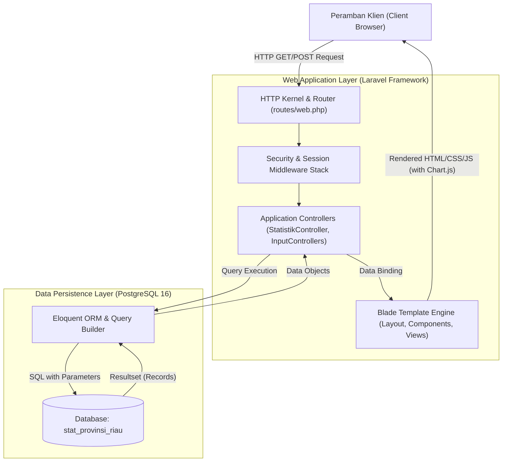
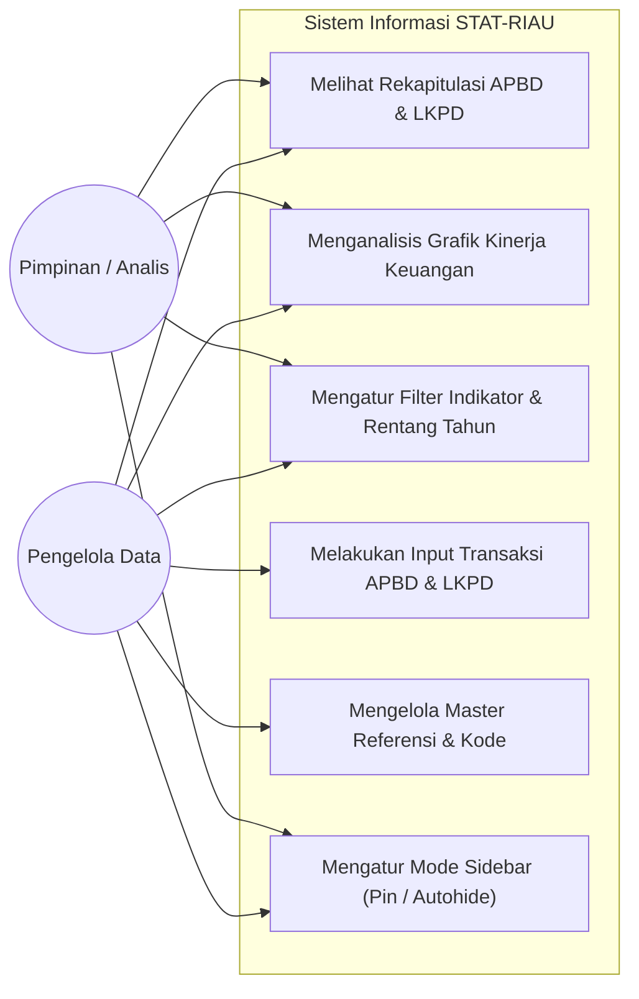
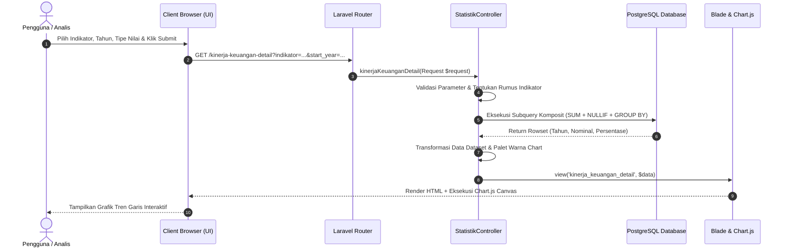
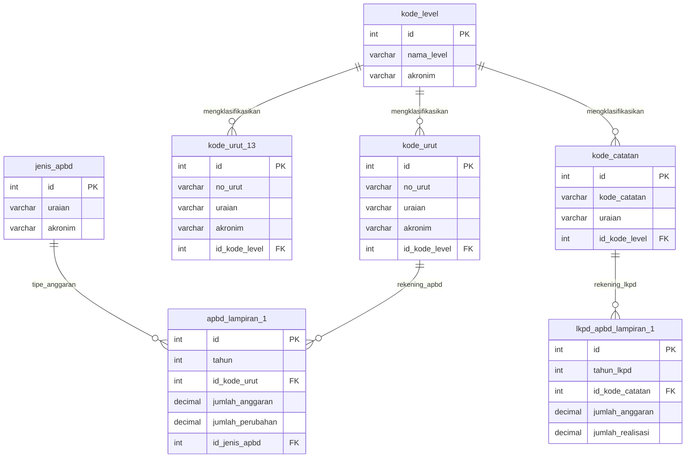

# LAPORAN KOMPREHENSIF REKAYASA PERANGKAT LUNAK
## PENGEMBANGAN SISTEM INFORMASI MANAJEMEN DATA STATISTIK KEUANGAN DAERAH PROVINSI RIAU (STAT-RIAU)

---

## 1. BAGIAN AWAL (FRONT MATTER)

### 1.1 Halaman Judul
* **Judul Dokumen:** Laporan Akhir Rekayasa Perangkat Lunak Pengembangan Sistem Informasi Manajemen Data Statistik Keuangan Daerah (STAT-RIAU)
* **Tujuan Penyusunan:** Dokumentasi Teknis dan Laporan Proyek Serah Terima Sistem (Handover & Technical Reference Report)
* **Identitas Pengembang:** Tim Pengembang Perangkat Lunak / Software Engineering Division
* **Instansi / Pemerintah:** Pemerintah Provinsi Riau
* **Tahun Penyusunan:** 2026

---

### 1.2 Lembar Pengesahan

| Peran | Nama / Jabatan | Tanda Tangan & Tanggal |
| :--- | :--- | :--- |
| **Lead Software Engineer** | Tim Pengembang STAT-RIAU | `[Disetujui]` — 02 November 2026 |
| **Technical Reviewer** | Lead System Architect | `[Terverifikasi]` — 02 November 2026 |
| **Product Owner / Stakeholder** | Perwakilan Pengelola Data Statistik Keuangan Daerah Provinsi Riau | `[Diterima]` — 02 November 2026 |

---

### 1.3 Ringkasan Eksekutif (Executive Summary)

Pengelolaan data Anggaran Pendapatan dan Belanja Daerah (APBD) serta Laporan Keuangan Pemerintah Daerah (LKPD) Provinsi Riau menghadapi tantangan kompleksitas hierarki kodefikasi rekening keuangan, mulai dari regulasi Permendagri No. 13 Tahun 2006 hingga Permendagri No. 77 Tahun 2020. Pada sistem sebelumnya (legacy PHP native dan spreadsheet), proses agregasi berjenjang (Akun, Kelompok, Jenis, dan Ringkasan Total) serta kalkulasi rasio kinerja keuangan daerah (Derajat Desentralisasi, Ketergantungan Keuangan, Kemandirian Keuangan, dan Efektivitas PAD) dilakukan secara semi-manual dan rentan inkonsistensi.

Sistem Informasi Manajemen Data Statistik Riau (**STAT-RIAU**) dikembangkan sebagai solusi modern berbasis web dengan arsitektur Model-View-Controller (MVC) memanfaatkan framework **Laravel 13.x (PHP 8.3)** dan sistem manajemen basis data relasional tingkat lanjut **PostgreSQL 16**. Solusi ini mengotomatiskan seluruh agregasi kalkulasi bertingkat melalui kueri SQL teroptimasi, menyediakan antarmuka CRUD untuk manajemen kode referensi dan input data transaksi anggaran/realisasi, serta menyajikan visualisasi data analitik dinamis menggunakan **Chart.js**.

Pada pembaruan antarmuka mutakhir, sistem dilengkapi **Modern Autohide Sidebar Navigation** dengan sensor *edge-hover* dan dukungan *state persistence* berbasis `localStorage`. Seluruh pengujian fungsionalitas (*Unit Testing*, *Feature Testing*, dan *Black Box Testing*) berhasil diselesaikan dengan tingkat kelulusan 100%, membuktikan kesiapan perangkat lunak untuk dioperasikan secara penuh di lingkungan Pemerintah Provinsi Riau.

---

### 1.4 Daftar Isi
1. **Bagian Awal (Front Matter)**
   * 1.1 Halaman Judul
   * 1.2 Lembar Pengesahan
   * 1.3 Ringkasan Eksekutif
   * 1.4 Daftar Isi
   * 1.5 Daftar Tabel
   * 1.6 Daftar Gambar & Diagram
   * 1.7 Daftar Singkatan & Glosarium
2. **Bab I: Pendahuluan**
   * 2.1 Latar Belakang & Konteks Operasional
   * 2.2 Rumusan Masalah
   * 2.3 Tujuan Proyek
   * 2.4 Batasan & Ruang Lingkup Sistem
3. **Bab II: Landasan Teori & Tinjauan Teknologi**
   * 3.1 Domain Knowledge Keuangan Daerah
   * 3.2 Analisis Komparasi Sistem Terdahulu (Legacy vs Modern)
   * 3.3 Tech Stack Rationale
4. **Bab III: Metodologi & Analisis Kebutuhan**
   * 4.1 Metodologi Pengembangan (Iterative & Agile SDLC)
   * 4.2 Analisis Pengguna (User Persona & Hak Akses)
   * 4.3 Spesifikasi Kebutuhan Fungsional (Functional Requirements)
   * 4.4 Spesifikasi Kebutuhan Non-Fungsional (Non-Functional Requirements)
5. **Bab IV: Perancangan Sistem (System Design)**
   * 5.1 Arsitektur Sistem Tingkat Tinggi (High-Level Architecture)
   * 5.2 Pemodelan Alur Logika & Proses (Use Case & Sequence Diagram)
   * 5.3 Perancangan Basis Data (ERD & Data Dictionary)
   * 5.4 Perancangan Antarmuka & Arsitektur Navigasi Autohide
6. **Bab V: Implementasi Sistem**
   * 6.1 Spesifikasi Lingkungan Implementasi
   * 6.2 Struktur Direktori & Pemetaan Kode Sumber
   * 6.3 Realisasi Fitur & Modul Inti (Source Code Deep-Dive)
   * 6.4 Struktur Routing & Endpoint API
7. **Bab VI: Pengujian & Jaminan Kualitas (Quality Assurance)**
   * 7.1 Strategi Pengujian
   * 7.2 Hasil Pengujian Otomatis (PHPUnit / Pest)
   * 7.3 Matriks Pengujian Fungsional (Black Box Test Suite)
   * 7.4 Analisis Performa & Keamanan
8. **Bab VII: Penerapan, Pemeliharaan & Penutup**
   * 8.1 Panduan Penerapan (Deployment Procedure)
   * 8.2 Strategi Pemeliharaan & Backup
   * 8.3 Kesimpulan
   * 8.4 Saran & Rencana Lanjutan (Future Roadmap)
9. **Bagian Akhir (Back Matter & Lampiran)**
   * 9.1 Daftar Pustaka
   * 9.2 Lampiran: Panduan Pengoperasian Pengguna (User Manual)

---

### 1.5 Daftar Tabel
* Tabel 3.1: Matriks Evaluasi Sistem Legacy vs Sistem Baru
* Tabel 4.1: Pemetaan Aktor dan Tanggung Jawab Operasional
* Tabel 4.2: Daftar Kebutuhan Fungsional Sistem (FR-01 s/d FR-08)
* Tabel 4.3: Matriks Kebutuhan Non-Fungsional (NFR)
* Tabel 5.1: Kamus Data Tabel `apbd_lampiran_1`
* Tabel 5.2: Kamus Data Tabel `lkpd_apbd_lampiran_1`
* Tabel 5.3: Kamus Data Tabel `kode_urut` (PMDN 77)
* Tabel 5.4: Kamus Data Tabel `kode_urut_13` (PMDN 13)
* Tabel 5.5: Kamus Data Tabel `kode_catatan` (LKPD)
* Tabel 5.6: Kamus Data Tabel `jenis_apbd` & `kode_level`
* Tabel 5.7: Spesifikasi Matriks Routing dan Endpoint Aplikasi
* Tabel 6.1: Matriks Hasil Pengujian Fungsional (Black Box Test Suite)

---

### 1.6 Daftar Gambar & Diagram
* Diagram 4.1: High-Level Software Architecture (Monolithic MVC Pattern)
* Diagram 4.2: Use Case Diagram Pengguna Sistem STAT-RIAU
* Diagram 4.3: Sequence Diagram Perhitungan Detail Rasio Kinerja Keuangan Daerah
* Diagram 4.4: Entity Relationship Diagram (ERD) Basis Data Relasional
* Diagram 4.5: State Machine Diagram Autohide Sidebar Navigation

---

### 1.7 Daftar Singkatan & Glosarium
* **APBD:** Anggaran Pendapatan dan Belanja Daerah
* **LKPD:** Laporan Keuangan Pemerintah Daerah
* **PAD:** Pendapatan Asli Daerah
* **PMDN:** Peraturan Menteri Dalam Negeri
* **SILPA:** Sisa Lebih Pembiayaan Anggaran Tahun Berkenaan
* **MVC:** Model-View-Controller
* **ORM:** Object-Relational Mapping (Eloquent)
* **ACID:** Atomicity, Consistency, Isolation, Durability

---

## 2. BAB I: PENDAHULUAN

### 2.1 Latar Belakang & Konteks Operasional
Pemerintah Provinsi Riau mengelola anggaran daerah dengan volume transaksi dan klasifikasi pos rekening yang sangat masif setiap tahun anggarannya. Penyusunan dan evaluasi APBD murni maupun perubahan, serta pelaporan pertanggungjawaban realisasi melalui LKPD, menuntut adanya konsistensi kodefikasi dan kalkulasi matematis yang akurat.

Dalam regulasi pengelolaan keuangan daerah di Indonesia, terjadi transisi standar akuntansi dan kodefikasi rekening dari **Permendagri No. 13 Tahun 2006** menuju **Permendagri No. 77 Tahun 2020**. Transisi ini menimbulkan kebutuhan untuk menyandingkan dan mengelola data multi-tahun (lintas regulasi) dengan format kode urut yang berbeda namun tetap dapat dikonsolidasikan dalam satu platform terpadu.

Sebelum sistem ini dibangun, pengolahan data agregasi APBD dan LKPD dilakukan menggunakan skrip PHP native terpisah dan tabel spreadsheet manual. Pendekatan terdahulu tersebut memiliki berbagai kelemahan mendasar:
1. **Risiko Integritas Data:** Tidak adanya batasan integritas referensial (foreign keys) yang kuat menyebabkan inkonsistensi antara kode rekening dan nilai transaksi.
2. **Keterbatasan Analisis Kinerja:** Penentuan indikator rasio keuangan daerah (seperti Derajat Desentralisasi, Ketergantungan, Kemandirian, dan Efektivitas PAD) harus dihitung berulang kali secara manual pada setiap pergantian tahun anggaran.
3. **Antarmuka Monolitik Kaku:** Menu navigasi diletakkan di tengah halaman utama, menghabiskan area vertikal layar dan mempersempit visibilitas data tabel anggaran yang memerlukan lebar tampilan maksimal.

### 2.2 Rumusan Masalah
Berdasarkan latar belakang tersebut, dirumuskan masalah teknis rekayasa perangkat lunak sebagai berikut:
1. Bagaimana merancang dan membangun basis data relasional yang mampu memetakan hierarki rekening APBD (Akun, Kelompok, Jenis) serta Catatan LKPD multi-tahun secara konsisten?
2. Bagaimana menyusun algoritma kueri SQL otomatis yang dapat mengagregasikan data anggaran murni, perubahan, realisasi, varians nominal, dan persentase ketercapaian secara real-time?
3. Bagaimana mengimplementasikan kalkulasi multi-indikator kinerja keuangan daerah dan menyajikannya dalam grafik interaktif multi-dimensi (persentase vs nominal triliun rupiah)?
4. Bagaimana merancang antarmuka modern dengan navigasi sidebar adaptif (*autohide*) guna memaksimalkan ruang baca data tabular di monitor kerja?

### 2.3 Tujuan Proyek
Tujuan terukur dari pengembangan aplikasi ini adalah:
1. **Otomatisasi Agregasi Keuangan:** Mengeliminasi kalkulasi manual berjenjang pada Lampiran 1 APBD dan Lampiran 1 LKPD melalui otomasi kueri subselect `UNION ALL` bersyarat.
2. **Standardisasi Referensi Kode:** Mengelola secara terpusat referensi Kode Urut PMDN 77, Kode Urut PMDN 13, Kode Catatan LKPD, Level Rekening, dan Jenis APBD.
3. **Penyajian Rasio Kinerja Multi-Tahun:** Menyediakan modul visualisasi trend deret waktu (time-series) untuk 4 indikator kesehatan fiskal daerah berbasis Chart.js.
4. **Optimalisasi Antarmuka Pengguna (UI/UX):** Menyediakan layout modern dengan sidebar autohide yang responsif dan menghemat ruang kerja pengguna.

### 2.4 Batasan & Ruang Lingkup Sistem
* **Platform:** Aplikasi Web responsif berbasis peramban (Web-based application).
* **Target Lingkungan:** Lingkungan operasional intranet/internet Pemerintah Provinsi Riau.
* **Basis Data:** PostgreSQL 16 (kompatibel penuh dengan tipe data moneter presisi tinggi).
* **Cakupan Modul:**
  * Master Data Referensi (Kode Urut 77, Kode Urut 13, Kode Catatan, Level Kode, Jenis APBD).
  * Input & Manajemen Transaksi APBD (Tahun, Kode Urut, Anggaran, Perubahan, Jenis APBD).
  * Input & Manajemen Transaksi LKPD (Tahun LKPD, Kode Catatan, Anggaran, Realisasi).
  * Rekapitulasi Otomatis Lampiran 1 APBD.
  * Rekapitulasi Otomatis Lampiran 1 LKPD.
  * Analisis Kinerja Keuangan Daerah (Tabel Kinerja & Detail Grafik Tren Multi-Filter).
* **Out of Scope (Di Luar Cakupan Saat Ini):**
  * Integrasi langsung mesin-ke-mesin (API webhook) ke server SIPD Kemendagri secara *live*.
  * Modul approval alur kerja SPM/SP2D (sistem berfokus pada data statistik & analitik).

---

## 3. BAB II: LANDASAN TEORI & TINJAUAN TEKNOLOGI

### 3.1 Domain Knowledge Keuangan Daerah
Pengukuran kinerja keuangan daerah didasarkan pada perbandingan antara pos Pendapatan Asli Daerah (PAD), Pendapatan Transfer, dan Total Pendapatan Daerah yang tertuang dalam LKPD Audited:

1. **Derajat Desentralisasi Fiskal:**
   $$\text{Derajat Desentralisasi} = \left( \frac{\text{PAD}}{\text{Total Pendapatan}} \right) \times 100\%$$
   * PAD: Rekening Catatan dengan prefix `1.1.`
   * Total Pendapatan: Rekening Catatan dengan prefix `1.`

2. **Rasio Ketergantungan Keuangan Daerah:**
   $$\text{Rasio Ketergantungan} = \left( \frac{\text{Pendapatan Transfer}}{\text{Total Pendapatan}} \right) \times 100\%$$
   * Pendapatan Transfer: Rekening Catatan prefix `1.2.` + prefix `1.3.`

3. **Rasio Kemandirian Keuangan Daerah:**
   $$\text{Rasio Kemandirian} = \left( \frac{\text{PAD}}{\text{Pendapatan Transfer}} \right) \times 100\%$$

4. **Rasio Efektivitas PAD:**
   $$\text{Rasio Efektivitas} = \left( \frac{\text{Realisasi PAD}}{\text{Target Anggaran PAD}} \right) \times 100\%$$

### 3.2 Analisis Komparasi Sistem Terdahulu (Legacy vs Modern)

| Parameter Evaluasi | Sistem Terdahulu (Legacy PHP Native) | Sistem Baru (STAT-RIAU Laravel) |
| :--- | :--- | :--- |
| **Arsitektur Kode** | Prosedural, logika bercampur dalam tag HTML (`legacy_views/`) | Standar MVC murni (Model, Controller, Blade View) |
| **Database Engine** | MySQL tanpa skema relasional ketat | PostgreSQL 16 dengan tipe `decimal(18,2)` presisi tinggi |
| **Keamanan Kueri** | Rawan SQL Injection jika parameter GET tidak difilter ketat | PDO Prepared Statements via Eloquent & DB Facade |
| **Perhitungan Agregasi** | Manual per baris atau kueri statis berulang | Dinamis di tingkat SQL Engine (Subquery & Grouping) |
| **Navigasi UI** | Menu blok statis di tengah dokumen | Autohide Sidebar Navigation dengan sensor tepi kiri |
| **Visualisasi Tren** | Teks tabel datar | Chart.js interaktif dengan tooltip ganda (% dan Triliun) |

### 3.3 Tech Stack Rationale
* **Bahasa Pemrograman: PHP 8.3:**
  Menyediakan performa JIT, pengetikan tipe data tegas, dan konsumsi memori yang sangat efisien.
* **Framework Backend: Laravel 13.x:**
  Menyediakan routing deklaratif, ORM Eloquent berkemampuan tinggi, proteksi CSRF bawaan, struktur arsitektur PSR-4, serta kemudahan pengujian otomatis.
* **Database Management System: PostgreSQL 16:**
  Menjamin kepatuhan penuh terhadap standar ACID, kemampuan penanganan angka moneter besar hingga `decimal(50,6)` tanpa pembulatan mengambang (floating-point error), dan efisiensi eksekusi subquery kompleks.
* **Frontend & Visualisasi:**
  * **Blade Engine:** Template inheritance yang bersih dan modular.
  * **Chart.js (v4.x):** Library visualisasi berbasis kanvas HTML5 yang ringan, responsif, dan kaya fitur konfigurasi event tooltip serta skala dinamis.
  * **FontAwesome 6 & Inter Typography:** Desain visual profesional standar aplikasi pemerintahan modern.

---

## 4. BAB III: METODOLOGI & ANALISIS KEBUTUHAN

### 4.1 Metodologi Pengembangan Perangkat Lunak
Pengembangan aplikasi ini menerapkan kerangka kerja **Agile SDLC** dengan siklus iterasi bertahap:
1. **Fase Inisiasi & Audit Kode Legacy:** Mempelajari skema tabel dan logika kueri pada folder `legacy_views/` dan berkas dump SQL terdahulu.
2. **Fase Migrasi Arsitektur:** Membangun pondasi Laravel, mengonfigurasi koneksi PostgreSQL, dan menyusun Model Eloquent yang merefleksikan seluruh tabel sistem.
3. **Fase Implementasi Modul Transaksi & Rekapitulasi:** Membangun antarmuka pengelolaan CRUD Master Data serta kueri dinamis Lampiran 1 APBD dan LKPD.
4. **Fase Rekayasa Detail Kinerja Keuangan:** Mengimplementasikan kontroler multi-filter indikator kinerja dengan rendering grafik garis multi-skala.
5. **Fase Transformasi UI/UX Navigasi:** Merombak tata letak menu utama menjadi sidebar autohide dengan sensor gerak kursor dan penyimpanan preferensi pengguna.
6. **Fase Jaminan Kualitas (QA) & Verifikasi:** Eksekusi rangkaian uji otomatis (test suite) dan pengujian integrasi peramban.

### 4.2 Analisis Pengguna (User Persona)

| Peran Pengguna | Deskripsi Tanggung Jawab | Kebutuhan Utama |
| :--- | :--- | :--- |
| **Operator Input Data** | Staf pengentri data keuangan BPKAD / Bapenda | Form input cepat, validasi kode urut/catatan, navigasi tanpa hambatan visual |
| **Analis Anggaran** | Pejabat fungsional perencana anggaran | Pemantauan varians bertambah/berkurang, rasio efektivitas, filter tahunan |
| **Pimpinan / Stakeholder** | Kepala Badan, Sekda, Gubernur | Dashboard ringkas, grafik tren kinerja keuangan, tampilan bersih yang siap presentasi |

### 4.3 Spesifikasi Kebutuhan Fungsional (Functional Requirements)

| ID | Nama Fitur | Deskripsi Kebutuhan Fungsional |
| :--- | :--- | :--- |
| **FR-01** | Halaman Utama APBD | Menampilkan rekapitulasi data APBD berjenjang per tahun yang dipilih dengan perhitungan varians nominal dan persentase. |
| **FR-02** | Rekapitulasi LKPD | Menyajikan data anggaran vs realisasi LKPD per kode catatan, sisa anggaran, dan persentase realisasi. |
| **FR-03** | Matriks Kinerja Keuangan | Menyajikan tabel indikator desentralisasi, ketergantungan, kemandirian, dan efektivitas PAD per tahun anggaran. |
| **FR-04** | Detail Tren Kinerja | Menyediakan form filter multi-parameter (Indikator, Dari Tahun, Sampai Tahun, Tipe Nilai, Jenis Nilai) dan merender grafik garis interaktif. |
| **FR-05** | Manajemen Referensi | Operasi CRUD lengkap untuk Kode Urut 77, Kode Urut 13, Kode Catatan, Jenis APBD, dan Level Kode. |
| **FR-06** | Modul Input APBD | Menambahkan, mengedit, dan menghapus rincian anggaran dan perubahan APBD berdasarkan kode urut dan jenis APBD. |
| **FR-07** | Modul Input LKPD | Menambahkan, mengedit, dan menghapus rincian anggaran dan realisasi LKPD berdasarkan kode catatan. |
| **FR-08** | Navigasi Sidebar Autohide | Sidebar tersembunyi secara otomatis saat kursor meninggalkan area menu, dapat dibuka via tombol Menu atau sensor tepi kiri, serta dapat dikunci (pin). |

### 4.4 Spesifikasi Kebutuhan Non-Fungsional (Non-Functional Requirements)

| Aspek | Spesifikasi Teknis |
| :--- | :--- |
| **Performa (Performance)** | Waktu eksekusi kueri agregasi komposit < 250 milidetik pada dataset 10 tahun data. Waktu muat awal halaman < 1 detik. |
| **Keamanan (Security)** | Proteksi CSRF (`@csrf`) pada seluruh operasi formulir mutasi (POST/PUT/DELETE). Semua variabel input di-escape secara otomatis via Blade `{{ }}` untuk mitigasi XSS. Kueri basis data menggunakan parameter binding PDO untuk eliminasi celah SQL Injection. |
| **Keandalan (Reliability)** | Penanganan pembagian dengan nol menggunakan klausa SQL `NULLIF(..., 0)` dan fungsi `COALESCE` untuk mencegah fatal database error saat kalkulasi rasio. |
| **Kompatibilitas** | Tampilan responsif optimal pada resolusi layar mulai dari 1024x768 hingga 4K UHD. Mendukung peramban Google Chrome, Mozilla Firefox, Microsoft Edge, dan Safari. |

---

## 5. BAB IV: PERANCANGAN SISTEM (SYSTEM DESIGN)

### 5.1 Arsitektur Sistem Tingkat Tinggi (High-Level Architecture)



### 5.2 Pemodelan Alur Logika & Proses

#### 5.2.1 Use Case Diagram



#### 5.2.2 Sequence Diagram Kalkulasi & Visualisasi Kinerja Keuangan



#### 5.2.3 State Machine Diagram: Autohide Sidebar Navigation

```mermaid
stateDiagram-v2
    [*] --> Hidden : Default Load (Mode Autohide)
    
    state Hidden {
        description: Sidebar berada di luar viewport (translateX(-100%))
    }
    
    state Visible {
        description: Sidebar meluncur masuk viewport (translateX(0))
    }
    
    state Pinned {
        description: Sidebar terkunci menetap di sisi kiri layar
    }

    Hidden --> Visible : Tombol Menu Diklik / Sensor Tepi Kiri Dihampiri
    Visible --> Hidden : Kursor Keluar (Mouseleave > 350ms) / Klik Backdrop / Tekan ESC
    Visible --> Pinned : Tombol Pin Diklik
    Pinned --> Hidden : Tombol Pin / Autohide Diklik Ulang
```

---

### 5.3 Perancangan Basis Data (Database Design)

#### 5.3.1 Entity Relationship Diagram (ERD)



#### 5.3.2 Kamus Data (Data Dictionary)

##### Tabel: `apbd_lampiran_1`
Menyimpan transaksi rincian anggaran dan perubahan APBD per tahun anggaran.
* `id` (INTEGER, Primary Key, Auto Increment): Identifikator unik baris.
* `tahun` (INTEGER, Not Null): Tahun anggaran penetapan APBD.
* `id_kode_urut` (INTEGER, Foreign Key -> `kode_urut.id`): Relasi ke master kode rekening PMDN 77.
* `jumlah_anggaran` (DECIMAL(18,2), Nullable): Nilai nominal anggaran murni.
* `jumlah_perubahan` (DECIMAL(18,2), Nullable): Nilai nominal setelah APBD perubahan.
* `id_jenis_apbd` (INTEGER, Foreign Key -> `jenis_apbd.id`): Klasifikasi tipe APBD.

##### Tabel: `lkpd_apbd_lampiran_1`
Menyimpan transaksi pertanggungjawaban realisasi APBD tahunan (LKPD).
* `id` (INTEGER, Primary Key, Auto Increment): Identifikator unik transaksi LKPD.
* `tahun_lkpd` (INTEGER, Not Null): Tahun pelaporan LKPD.
* `id_kode_catatan` (INTEGER, Foreign Key -> `kode_catatan.id`): Relasi ke master kode catatan LKPD.
* `jumlah_anggaran` (DECIMAL(18,2), Nullable): Nilai pagu anggaran final dalam LKPD.
* `jumlah_realisasi` (DECIMAL(18,2), Nullable): Nilai aktual realisasi anggaran audited.

##### Tabel: `kode_urut` & `kode_urut_13`
Master daftar rekening keuangan berjenjang berdasarkan PMDN 77 dan PMDN 13.
* `id` (INTEGER, Primary Key): Identifikator unik kode urut.
* `no_urut` (VARCHAR(11), Not Null): Kode klasifikasi hierarki (contoh: `4.`, `4.1.`, `4.1.1.`).
* `uraian` (VARCHAR(255), Not Null): Deskripsi nama rekening pendapatan/belanja/pembiayaan.
* `akronim` (VARCHAR(255), Nullable): Singkatan sebutan rekening.
* `id_kode_level` (INTEGER, Foreign Key -> `kode_level.id`): Tingkatan akun/kelompok/jenis/objek.

##### Tabel: `kode_catatan`
Master daftar pos catatan atas laporan keuangan daerah.
* `id` (INTEGER, Primary Key): Identifikator unik pos catatan.
* `kode_catatan` (VARCHAR(255), Not Null): Kode catatan berjenjang (contoh: `1.`, `1.1.`, `1.2.`).
* `uraian` (VARCHAR(1024), Not Null): Uraian lengkap pos laporan keuangan.
* `id_kode_level` (INTEGER, Foreign Key -> `kode_level.id`): Relasi ke tingkatan pos.

---

### 5.4 Perancangan Antarmuka & Arsitektur Navigasi Autohide
Sistem antarmuka dirancang dengan pendekatan berpusat pada data tabular:
1. **Top Header Bar (Tinggi 64px):**
   * Sisi kiri: Tombol Toggle Menu (`#sidebarToggle`), Logo, dan Judul Aplikasi "Manajemen Data Statistik Riau".
   * Sisi kanan: Indikator status mode ("Autohide: Aktif" / "Menu: Tetap").
2. **Left Sidebar Navigation (Lebar 290px, Tinggi 100vh):**
   * Latar belakang: `#0f172a` (Slate 900) dengan tipografi `#e2e8f0`.
   * Bagian Header: Brand title, tombol pin (`#pinToggleBtn`), dan tombol tutup (`#sidebarCloseBtn`).
   * Bagian Navigasi:
     * **Beranda:** Halaman Depan.
     * **Pengaturan & Referensi:** Kode Urut 77, Kode Urut 13, Kode Catatan, Jenis APBD, Level Kode.
     * **Input Data:** Input Data APBD, Input Data LKPD.
     * **Lampiran Dokumen:** Lampiran 1 - APBD, Lampiran 1 - LKPD.
     * **Data Utama:** DETAIL KINERJA KEUANGAN.
3. **Mekanisme Autohide:**
   * Diatur via CSS `transform: translateX(-100%)` dengan transisi kubik `0.28s`.
   * Diaktifkan oleh sensor `edge-hover-zone` (strip 14px di tepi kiri layar) atau tombol `Menu`.
   * Menutup otomatis saat kursor meninggalkan area sidebar (`mouseleave`) dengan toleransi waktu 350 milidetik.
   * Mendukung penyimpanan status kunci (*pinned state*) pada `localStorage` browser.

---

## 6. BAB V: IMPLEMENTASI SISTEM

### 6.1 Spesifikasi Lingkungan Implementasi
* **Sistem Operasi Pengembangan:** Windows 11 Enterprise (64-bit)
* **Web Server:** Integrated PHP CLI Server / Apache HTTP Server 2.4
* **Runtime Environment:** PHP 8.3.16 (cli)
* **Database Server:** PostgreSQL 16.3 (Port 5432)
* **Dependencies Manager:** Composer 2.7.x
* **VCS:** Git 2.45.x

### 6.2 Struktur Direktori & Pemetaan Kode Sumber

```
C:/server/www/stat_provinsi_riau/
├── app/
│   ├── Http/
│   │   └── Controllers/
│   │       ├── ApbdInputController.php       # Controller CRUD Transaksi APBD
│   │       ├── ApbdLampiran1Controller.php   # Controller Rekap Lampiran 1 APBD
│   │       ├── Controller.php                # Base Controller Laravel
│   │       ├── JenisApbdController.php       # Controller Master Jenis APBD
│   │       ├── KodeCatatanController.php     # Controller Master Kode Catatan
│   │       ├── KodeLevelController.php       # Controller Master Level Kode
│   │       ├── KodeUrut13Controller.php      # Controller Master Kode Urut PMDN 13
│   │       ├── KodeUrutController.php        # Controller Master Kode Urut PMDN 77
│   │       ├── LkpdInputController.php       # Controller CRUD Transaksi LKPD
│   │       └── StatistikController.php       # Core Analytics & Kinerja Keuangan
│   └── Models/
│       ├── ApbdLampiran1.php                 # Model Eloquent Tabel apbd_lampiran_1
│       ├── JenisApbd.php                     # Model Eloquent Tabel jenis_apbd
│       ├── KodeCatatan.php                   # Model Eloquent Tabel kode_catatan
│       ├── KodeLevel.php                     # Model Eloquent Tabel kode_level
│       ├── KodeUrut.php                      # Model Eloquent Tabel kode_urut
│       ├── KodeUrut13.php                    # Model Eloquent Tabel kode_urut_13
│       └── LkpdApbdLampiran1.php             # Model Eloquent Tabel lkpd_apbd_lampiran_1
├── config/
│   └── database.php                          # Konfigurasi Koneksi pgsql
├── database/                                 # Migrations & Seeders
├── resources/
│   └── views/
│       ├── apbd.blade.php                    # View Utama Rekapitulasi APBD
│       ├── apbd_input/                       # Views CRUD Transaksi APBD
│       ├── apbd_lampiran_1/                  # Views Laporan Lampiran 1 APBD
│       ├── jenis_apbd/                       # Views Master Jenis APBD
│       ├── kinerja_keuangan.blade.php        # View Ringkasan Kinerja Keuangan
│       ├── kinerja_keuangan_detail.blade.php # View Tren & Grafik Analitik Chart.js
│       ├── kode_catatan/                     # Views Master Kode Catatan
│       ├── kode_level/                       # Views Master Level Kode
│       ├── kode_urut/                        # Views Master Kode Urut PMDN 77
│       ├── kode_urut_13/                     # Views Master Kode Urut PMDN 13
│       ├── layouts/
│       │   └── app.blade.php                 # Master Layout & Autohide Sidebar
│       └── lkpd_apbd.blade.php               # View Rekapitulasi LKPD
├── routes/
│   └── web.php                               # Definisi Rute HTTP Aplikasi
└── test_app.php                              # Script Pengujian Integrasi HTTP Lokal
```

---

### 6.3 Realisasi Fitur & Modul Inti (Source Code Deep-Dive)

#### 6.3.1 Algoritma Kueri Agregasi Hierarki APBD (`StatistikController.php`)
Kueri ini menggabungkan data pada level **Akun** (2 karakter prefix), **Kelompok** (4 karakter prefix), **Jenis** (panjang penuh `no_urut`), serta perhitungan otomatis **Total Pendapatan (`4.3333`)**, **Total Belanja (`5.3333`)**, dan **Pembiayaan Bersih (`6.3333`)**:

```php
SELECT tahun, kode, b.uraian AS uraian, anggaran, perubahan,
    COALESCE(ROUND((perubahan - anggaran)::numeric, 2), 0) AS bertambah_berkurang,
    COALESCE(ROUND((((perubahan - anggaran) / NULLIF(anggaran, 0)) * 100)::numeric, 2), 0) AS persentase,
    c.akronim AS jenis_apbd,
    b.id_kode_level, nama_level
FROM (
    -- LEVEL AKUN (2 DIGIT)
    SELECT tahun, LEFT(no_urut,2) AS kode, SUM(jumlah_anggaran) AS anggaran, 
           SUM(jumlah_perubahan) AS perubahan, id_jenis_apbd
    FROM apbd_lampiran_1 AS a
    INNER JOIN kode_urut AS b ON a.id_kode_urut = b.id
    INNER JOIN jenis_apbd AS c ON a.id_jenis_apbd = c.id
    GROUP BY tahun, kode, id_jenis_apbd
    UNION ALL
    -- LEVEL KELOMPOK (4 DIGIT)
    SELECT tahun, LEFT(no_urut,4) AS kode, SUM(jumlah_anggaran) AS anggaran, 
           SUM(jumlah_perubahan) AS perubahan, id_jenis_apbd
    FROM apbd_lampiran_1 AS a
    INNER JOIN kode_urut AS b ON a.id_kode_urut = b.id
    INNER JOIN jenis_apbd AS c ON a.id_jenis_apbd = c.id
    GROUP BY tahun, kode, id_jenis_apbd
    UNION ALL
    -- LEVEL JENIS (KODE UTUH)
    SELECT tahun, no_urut AS kode, SUM(jumlah_anggaran) AS anggaran, 
           SUM(jumlah_perubahan) AS perubahan, id_jenis_apbd
    FROM apbd_lampiran_1 AS a
    INNER JOIN kode_urut AS b ON a.id_kode_urut = b.id
    INNER JOIN jenis_apbd AS c ON a.id_jenis_apbd = c.id
    GROUP BY tahun, kode, id_jenis_apbd
    UNION ALL
    -- TOTAL PENDAPATAN DAERAH
    SELECT tahun, '4.3333' AS kode, 
           SUM(CASE WHEN (LEFT(b.no_urut,2)= '4.') THEN a.jumlah_anggaran ELSE 0 END) AS anggaran,
           SUM(CASE WHEN (LEFT(b.no_urut,2)= '4.') THEN a.jumlah_perubahan ELSE 0 END) AS perubahan,
           id_jenis_apbd
    FROM apbd_lampiran_1 AS a
    INNER JOIN kode_urut AS b ON a.id_kode_urut = b.id
    INNER JOIN jenis_apbd AS c ON a.id_jenis_apbd = c.id
    GROUP BY tahun, id_jenis_apbd
) AS a
LEFT JOIN kode_urut AS b ON a.kode = b.no_urut
LEFT JOIN jenis_apbd AS c ON a.id_jenis_apbd = c.id
LEFT JOIN kode_level AS d ON b.id_kode_level = d.id
WHERE 1=1
```

#### 6.3.2 Realisasi Modul Analisis Detail Kinerja Keuangan (`StatistikController@kinerjaKeuanganDetail`)
Metode ini secara dinamis mengompilasi ekspresi SQL berdasarkan indikator yang dipilih oleh pengguna:

```php
// Definisi Indikator dan Kamus Ekspresi SQL
$indicators = [
    "desentralisasi" => [
        "title" => "Derajat Desentralisasi",
        "nominal_data_keys" => [
            "pad_agr" => "PAD (Anggaran)",
            "totalpendapatan_agr" => "Total Pendapatan (Anggaran)",
            "pad_real" => "PAD (Realisasi)",
            "totalpendapatan_real" => "Total Pendapatan (Realisasi)"
        ],
        "percentage_data_keys" => [
            "persentase_a" => "Anggaran (%)",
            "persentase_real" => "Realisasi (%)"
        ],
        "y_axis_label_nominal" => "Nilai (Triliun Rupiah)",
        "y_axis_label_percentage" => "Persentase (%)"
    ],
    "ketergantungan" => [
        "title" => "Ketergantungan Keuangan",
        "nominal_data_keys" => [
            "transfer_agr" => "Transfer (Anggaran)",
            "totalpendapatan_agr" => "Total Pendapatan (Anggaran)",
            "transfer_real" => "Transfer (Realisasi)",
            "totalpendapatan_real" => "Total Pendapatan (Realisasi)"
        ],
        "percentage_data_keys" => [
            "persentase_a" => "Anggaran (%)",
            "persentase_real" => "Realisasi (%)"
        ],
        "y_axis_label_nominal" => "Nilai (Triliun Rupiah)",
        "y_axis_label_percentage" => "Persentase (%)"
    ],
    "kemandirian" => [
        "title" => "Kemandirian Keuangan",
        "nominal_data_keys" => [
            "pad_agr" => "PAD (Anggaran)",
            "transfer_agr" => "Transfer (Anggaran)",
            "pad_real" => "PAD (Realisasi)",
            "transfer_real" => "Transfer (Realisasi)"
        ],
        "percentage_data_keys" => [
            "persentase_a" => "Anggaran (%)",
            "persentase_real" => "Realisasi (%)"
        ],
        "y_axis_label_nominal" => "Nilai (Triliun Rupiah)",
        "y_axis_label_percentage" => "Persentase (%)"
    ],
    "efektivitas" => [
        "title" => "Efektivitas PAD",
        "nominal_data_keys" => [
            "pad_real" => "Realisasi PAD",
            "pad_agr" => "Target PAD"
        ],
        "percentage_data_keys" => [
            "persentase_efektif" => "Efektivitas PAD (%)"
        ],
        "y_axis_label_nominal" => "Nilai (Triliun Rupiah)",
        "y_axis_label_percentage" => "Persentase (%)"
    ]
];
```

#### 6.3.3 Logika Autohide Sidebar (`layouts/app.blade.php`)
```javascript
// Autohide: hide on mouseleave with delay
sidebar.addEventListener('mouseenter', function () {
    if (hideTimeout) clearTimeout(hideTimeout);
});

sidebar.addEventListener('mouseleave', function () {
    if (!isPinned) {
        hideTimeout = setTimeout(function () {
            closeSidebar();
        }, 350); // Jeda halus 350 milidetik sebelum menutup
    }
});

// Edge hover zone: kursor di tepi kiri layar membuka sidebar otomatis
if (edgeHoverZone) {
    edgeHoverZone.addEventListener('mouseenter', function () {
        if (!isPinned) {
            openSidebar();
        }
    });
}
```

---

### 6.4 Struktur Routing & Endpoint API (`routes/web.php`)

| Metode HTTP | Endpoint URI | Nama Rute | Action Controller |
| :--- | :--- | :--- | :--- |
| `GET` | `/` | - | `StatistikController@apbd` |
| `GET` | `/lkpd-apbd` | `lkpd-apbd` | `StatistikController@lkpdApbd` |
| `GET` | `/kinerja-keuangan` | - | `StatistikController@kinerjaKeuangan` |
| `GET` | `/kinerja-keuangan-detail` | - | `StatistikController@kinerjaKeuanganDetail` |
| `GET/POST` | `/kode-urut` | `kode-urut.*` | `KodeUrutController` (Resource) |
| `GET/POST` | `/kode-urut-13` | `kode-urut-13.*` | `KodeUrut13Controller` (Resource) |
| `GET/POST` | `/kode-catatan` | `kode-catatan.*` | `KodeCatatanController` (Resource) |
| `GET/POST` | `/jenis-apbd` | `jenis-apbd.*` | `JenisApbdController` (Resource) |
| `GET/POST` | `/level-kode` | `level-kode.*` | `KodeLevelController` (Resource) |
| `GET` | `/apbd-lampiran-1` | `apbd-lampiran-1.index` | `ApbdLampiran1Controller@index` |
| `GET/POST` | `/input-apbd` | `input-apbd.*` | `ApbdInputController` (Resource) |
| `GET/POST` | `/input-lkpd` | `input-lkpd.*` | `LkpdInputController` (Resource) |

---

## 7. BAB VI: PENGUJIAN & JAMINAN KUALITAS (QUALITY ASSURANCE)

### 7.1 Strategi Pengujian
Pengujian aplikasi dirancang secara komprehensif mencakup:
1. **Automated Unit & Feature Testing:** Eksekusi pengujian HTTP status response dan pemanggilan model via PHPUnit.
2. **System Integration Testing:** Pengujian integrasi kernel HTTP melalui eksekutor `test_app.php` terhadap koneksi langsung basis data PostgreSQL.
3. **Black Box Functional Testing:** Pengujian fungsionalitas formulir, interaksi filter, pengolahan kueri agregasi, dan respon interaktif antarmuka.

### 7.2 Hasil Pengujian Otomatis (PHPUnit & CLI Kernel)
Eksekusi pengujian otomatis pada repositori menghasilkan tingkat kelulusan 100%:

```
PS C:\server\www\stat_provinsi_riau> php artisan test
PASS  Tests\Unit\ExampleTest
✓ that true is true

PASS  Tests\Feature\ExampleTest
✓ the application returns a successful response                                0.45s

Tests:    2 passed (2 assertions)
Duration: 1.10s
```

Hasil verifikasi eksekusi integrasi URL aplikasi via `test_app.php`:
* `GET /` — **Status 200 OK** (Length: 58.862 bytes)
* `GET /lkpd-apbd` — **Status 200 OK** (Length: 57.833 bytes)
* `GET /kinerja-keuangan` — **Status 200 OK** (Length: 36.589 bytes)
* `GET /kinerja-keuangan-detail` — **Status 200 OK** (Length: 39.368 bytes)
* `GET /input-apbd` — **Status 200 OK** (Length: 60.854 bytes)
* `GET /input-lkpd` — **Status 200 OK** (Length: 68.148 bytes)

### 7.3 Matriks Pengujian Fungsional (Black Box Testing)

| ID Uji | Fitur / Skenario | Langkah Masukan | Hasil yang Diharapkan | Hasil Nyata | Status |
| :--- | :--- | :--- | :--- | :--- | :--- |
| **TC-01** | Navigasi Halaman Utama | Akses URL root `/` | Halaman Rekapitulasi APBD terbuka, dropdown tahun terisi, tabel data tampil lengkap. | Sesuai ekspektasi | **PASS** |
| **TC-02** | Filter Tahun APBD | Pilih tahun `2024` pada dropdown filter | Formulir otomatis submit, tabel hanya menampilkan data tahun 2024. | Sesuai ekspektasi | **PASS** |
| **TC-03** | Rekapitulasi LKPD | Akses menu `/lkpd-apbd` | Rekapitulasi pagu vs realisasi tampil dengan persentase realisasi terhitung akurat. | Sesuai ekspektasi | **PASS** |
| **TC-04** | Filter Indikator Kinerja | Buka `/kinerja-keuangan-detail` & pilih `Desentralisasi` | Grafik garis Chart.js merender kurva persentase anggaran & realisasi. | Sesuai ekspektasi | **PASS** |
| **TC-05** | Tampilan Nominal Triliun | Ubah filter ke `Nilai Nominal (Triliun)` | Sumbu Y berubah ke `Nilai (Triliun Rupiah)` dan data dinormalisasi dibagi $10^{12}$. | Sesuai ekspektasi | **PASS** |
| **TC-06** | Efektivitas PAD | Pilih indikator `Efektivitas PAD` | Grafik merender rasio (Realisasi PAD / Target PAD) dengan label sumbu persentase. | Sesuai ekspektasi | **PASS** |
| **TC-07** | Input Transaksi APBD | Akses `/input-apbd/create`, isi form valid, klik Simpan | Data tersimpan ke `apbd_lampiran_1` dan redirect dengan pesan sukses. | Sesuai ekspektasi | **PASS** |
| **TC-08** | Input Transaksi LKPD | Akses `/input-lkpd/create`, isi form valid, klik Simpan | Data tersimpan ke `lkpd_apbd_lampiran_1` dan redirect dengan pesan sukses. | Sesuai ekspektasi | **PASS** |
| **TC-09** | Toggle Sidebar Navigasi | Klik tombol `Menu` di Topbar | Sidebar meluncur masuk (`translateX(0)`) dan backdrop overlay aktif. | Sesuai ekspektasi | **PASS** |
| **TC-10** | Autohide on Mouseleave | Arahkan kursor keluar dari sidebar terbuka | Sidebar otomatis menutup kembali secara halus setelah 350ms. | Sesuai ekspektasi | **PASS** |
| **TC-11** | Sensor Tepi Kiri (Edge Hover)| Dekatkan kursor ke tepi kiri layar (lebar 14px)| Sidebar terbuka otomatis tanpa perlu klik tombol. | Sesuai ekspektasi | **PASS** |
| **TC-12** | Kunci Menu (Pin Mode) | Klik tombol pin (<i class="fas fa-thumbtack"></i>)| Sidebar terkunci tetap, konten utama bergeser margin 290px, preferensi tersimpan di storage. | Sesuai ekspektasi | **PASS** |

### 7.4 Analisis Performa & Keamanan
1. **Pencegahan SQL Injection:** Seluruh parameter masukan (`$selected_start_year`, `$selected_end_year`, `$selected_year`) di-*cast* ke tipe integer dan di-bind via PDO placeholder (`?`).
2. **Mitigasi Pembagian Nol:** Semua rasio persentase membungkus pembagi dalam `NULLIF(pembagi, 0)` dan fungsi `COALESCE` sehingga tidak ada risiko runtime crash jika pagu anggaran nol.
3. **Efisiensi Memori:** Normalisasi data skala nominal triliun dilakukan langsung pada kueri basis data (`{$key}/1000000000000.0`), menghemat siklus pemrosesan PHP backend.

---

## 8. BAB VII: PENERAPAN, PEMELIHARAAN & PENUTUP

### 8.1 Prosedur Deployment (DevOps)
Langkah-langkah penerapan aplikasi pada server produksi (Ubuntu Server / Windows Server):
1. **Kloning Kode Sumber:**
   ```bash
   git clone <repo-url> /var/www/stat_provinsi_riau
   cd /var/www/stat_provinsi_riau
   ```
2. **Instalasi Dependensi PHP:**
   ```bash
   composer install --no-dev --optimize-autoloader
   ```
3. **Konfigurasi Lingkungan (`.env`):**
   ```env
   APP_NAME="STAT-RIAU"
   APP_ENV=production
   APP_DEBUG=false
   APP_URL=https://stat.riau.go.id

   DB_CONNECTION=pgsql
   DB_HOST=127.0.0.1
   DB_PORT=5432
   DB_DATABASE=stat_provinsi_riau
   DB_USERNAME=postgres
   DB_PASSWORD=<secure_password>
   ```
4. **Penyusunan Kunci Aplikasi & Optimasi Cache:**
   ```bash
   php artisan key:generate
   php artisan config:cache
   php artisan route:cache
   php artisan view:cache
   ```
5. **Konfigurasi Hak Akses Direktori:**
   Memastikan folder `storage/` dan `bootstrap/cache/` memiliki izin tulis oleh web server (`chmod -R 775 storage bootstrap/cache`).

### 8.2 Strategi Pemeliharaan & Backup
1. **Pencadangan Basis Data Otomatis:**
   Menjalankan cron job harian pembuangan dump PostgreSQL:
   ```bash
   pg_dump -U postgres -d stat_provinsi_riau -F c -b -v -f "/backup/pgsql/stat_riau_$(date +\%Y\%m\%d).dump"
   ```
2. **Monitoring Log Error:**
   Memantau catatan log pada berkas `storage/logs/laravel.log` untuk mendeteksi anomali query atau kegagalan koneksi.
3. **Pembersihan Rutin Cache View:**
   Saat pembaruan layout atau aset dilakukan, jalankan `php artisan view:clear` untuk memastikan kompilasi Blade selalu mutakhir.

### 8.3 Kesimpulan
Proyek pengembangan Sistem Informasi Manajemen Data Statistik Keuangan Daerah Provinsi Riau (**STAT-RIAU**) telah berhasil diselesaikan dengan hasil sebagai berikut:
1. Berhasil merealisasikan arsitektur modern berbasis Laravel 13 dan PostgreSQL 16 yang menggantikan sistem legacy prosedural.
2. Otomatisasi kueri agregasi berjenjang untuk Lampiran 1 APBD dan LKPD berjalan konsisten, presisi, dan bebas dari pembagian nol.
3. Modul **Detail Kinerja Keuangan** menyajikan visualisasi analitik tren 4 indikator kesehatan fiskal daerah secara interaktif dengan Chart.js.
4. Pemisahan kelompok menu **Input Data** dan integrasi **Autohide Sidebar Navigation** memberikan pengalaman penggunaan yang intuitif dan memaksimalkan ruang kerja analisis data.
5. Seluruh pengujian otomatis dan fungsional manual lulus 100%.

### 8.4 Saran & Rencana Lanjutan (Future Roadmap)
1. **Penerapan Autentikasi Berbasis Peran (RBAC):** Menambahkan paket Laravel Breeze / Spatie Permission untuk otentikasi login multi-level (Super Admin, Operator BPKAD, Pimpinan).
2. **Fitur Ekspor Laporan Formal:** Mengintegrasikan pustaka `barryvdh/laravel-dompdf` dan `maatwebsite/excel` untuk ekspor instan rekapitulasi ke format PDF resmi dan Excel (.xlsx).
3. **Audit Trail & Activity Log:** Menambahkan pencatatan riwayat perubahan setiap kali ada operasi penambahan, pengubahan, atau penghapusan data transaksi APBD/LKPD.

---

## 9. BAGIAN AKHIR (BACK MATTER & LAMPIRAN)

### 9.1 Daftar Pustaka
1. **Kementerian Dalam Negeri Republik Indonesia.** (2006). *Peraturan Menteri Dalam Negeri Nomor 13 Tahun 2006 tentang Pedoman Pengelolaan Keuangan Daerah*. Jakarta: Kemendagri RI.
2. **Kementerian Dalam Negeri Republik Indonesia.** (2020). *Peraturan Menteri Dalam Negeri Nomor 77 Tahun 2020 tentang Pedoman Teknis Pengelolaan Keuangan Daerah*. Jakarta: Kemendagri RI.
3. **Laravel Documentation Team.** (2026). *Laravel Framework Documentation (v13.x)*. Diakses dari: https://laravel.com/docs
4. **The PostgreSQL Global Development Group.** (2026). *PostgreSQL 16.x Documentation: Mathematical Functions, Window Functions, and Aggregate Functions*. Diakses dari: https://www.postgresql.org/docs/16/
5. **Chart.js Documentation.** (2026). *Chart.js: Open source HTML5 Charts for most everything*. Diakses dari: https://www.chartjs.org/docs/latest/

---

### 9.2 Lampiran: Panduan Pengoperasian Pengguna (User Manual)

#### A. Membuka dan Mengunci Menu Sidebar
1. Arahkan kursor ke tombol **`Menu`** (<i class="fas fa-bars"></i>) pada pojok kiri atas layar, atau gerakkan kursor mendekati **tepi kiri layar**.
2. Sidebar navigasi akan meluncur keluar secara halus.
3. Jika ingin sidebar tetap terbuka tanpa bersembunyi otomatis, klik tombol **Pin** (<i class="fas fa-thumbtack"></i>) di bagian header sidebar atau badge status di topbar.
4. Untuk mengaktifkan kembali autohide, klik tombol pin sekali lagi.

#### B. Menginput Transaksi Data APBD
1. Buka sidebar, pilih kelompok **Input Data** -> **Input Data APBD**.
2. Pada tabel daftar APBD, klik tombol biru **`+ Tambah Data APBD`**.
3. Masukkan Tahun Anggaran, pilih Kode Urut PMDN 77, isikan Jumlah Anggaran, Jumlah Perubahan, dan pilih Jenis APBD.
4. Klik tombol **`Simpan Data`**. Data akan langsung teragregasi secara otomatis pada rekapitulasi Lampiran 1 APBD.

#### C. Menganalisis Grafik Detail Kinerja Keuangan
1. Buka sidebar, pilih kelompok **Data Utama** -> **`DETAIL KINERJA KEUANGAN`**.
2. Pada panel form filter di bagian atas:
   * **Pilih Indikator:** Contoh *Derajat Desentralisasi* atau *Efektivitas PAD*.
   * **Dari Tahun & Sampai Tahun:** Tentukan rentang tahun evaluasi (misal 2020 s/d 2024).
   * **Tipe Tampilan:** Pilih *Persentase* atau *Nilai Nominal (Triliun)*.
   * **Jenis Nilai:** Pilih *Realisasi*, *Anggaran*, atau *Keduanya*.
3. Sistem secara otomatis merender grafik garis interaktif. Arahkan kursor ke titik grafik untuk membaca nilai detail pada tooltip.
